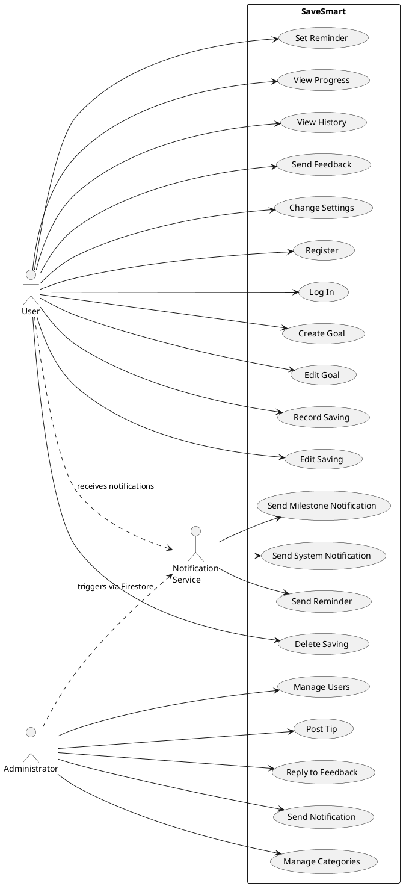
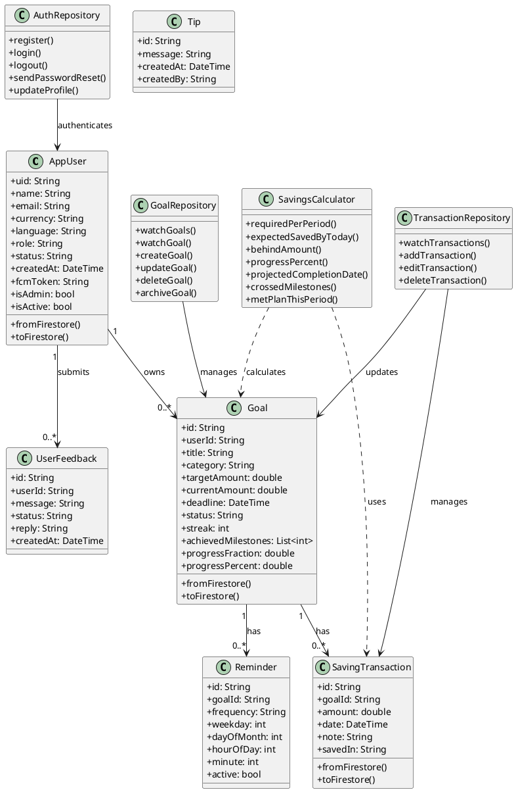
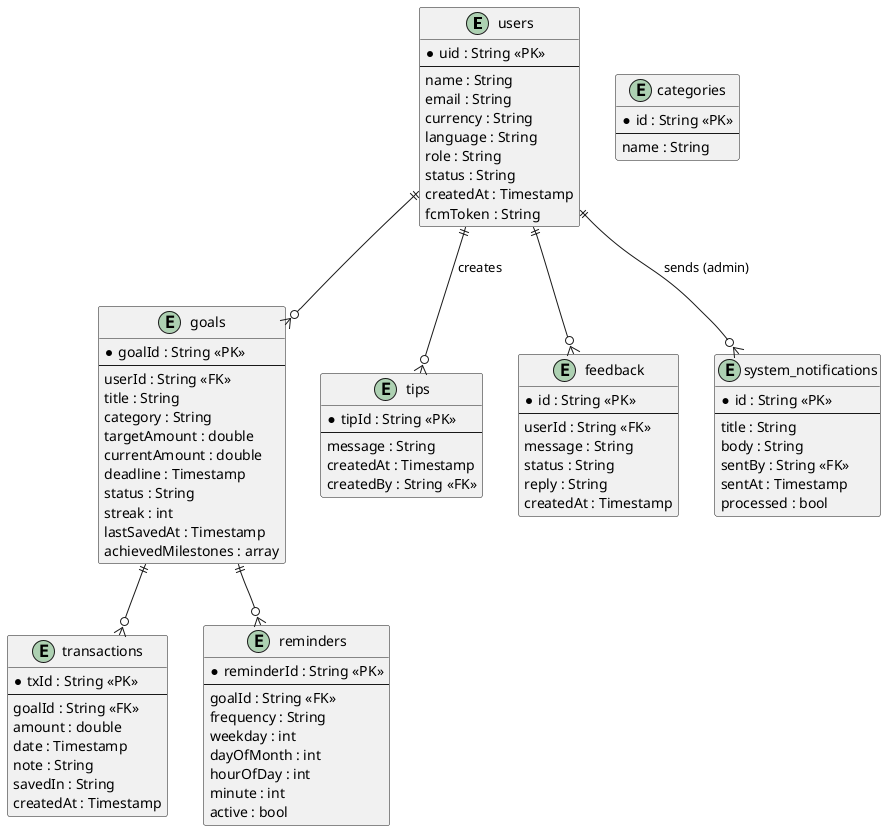
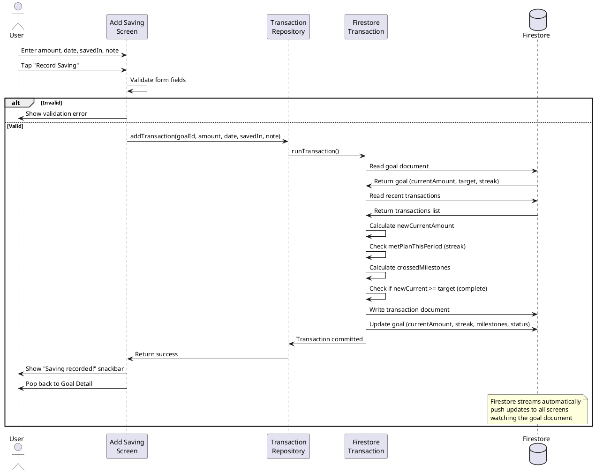
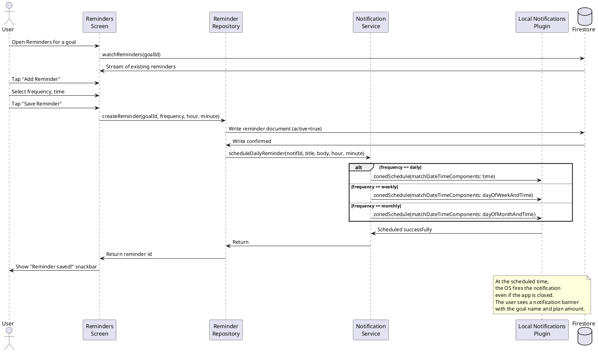

# SaveSmart — Project Documentation for Graduation Report

This file contains all the documentation you need for your thesis defense:
use case descriptions, UML diagrams (PlantUML source), and sequence diagrams.

---

## 1. Use Case Descriptions

### UC-1: Register Account

| Field | Value |
|---|---|
| **Actor** | User |
| **Precondition** | User has not registered before |
| **Main flow** | 1. User opens app → Onboarding → Login screen. 2. User taps "Create Account". 3. User enters name, email, password, confirm password. 4. System validates fields. 5. System creates Firebase Auth account. 6. System creates Firestore user document with role=user, status=active. 7. System logs in the user and navigates to Home. |
| **Alternative flows** | A1: Email already exists → System shows "account already exists" error. A2: Password < 6 chars → validator shows "at least 6 characters". |
| **Postcondition** | User is logged in and on Home screen |

### UC-2: Log In

| Field | Value |
|---|---|
| **Actor** | User |
| **Precondition** | User has a registered account |
| **Main flow** | 1. User enters email and password. 2. System validates format. 3. System calls Firebase Auth signIn. 4. System loads Firestore user document. 5. System checks status != suspended. 6. System navigates to Home. |
| **Alternative flows** | A1: Wrong password → "Invalid email or password". A2: Account suspended → "Your account has been suspended". |
| **Postcondition** | User is on Home screen with goals loaded |

### UC-3: Create Savings Goal

| Field | Value |
|---|---|
| **Actor** | User |
| **Precondition** | User is logged in |
| **Main flow** | 1. User taps "New Goal" FAB. 2. User enters title, selects category, enters target amount, picks deadline, optionally picks color. 3. User taps "Create Goal". 4. System validates all fields. 5. System writes goal document to Firestore with status=active, streak=0. 6. System pops back to Home. 7. Goal appears in the list. |
| **Postcondition** | Goal is visible on Home screen and its detail screen is accessible |

### UC-4: Record Saving

| Field | Value |
|---|---|
| **Actor** | User |
| **Precondition** | User has at least one active goal |
| **Main flow** | 1. User opens a goal. 2. User taps "Record Saving" FAB. 3. User enters amount, selects date, selects "Saved In" (Bank/Wallet/Cash/Group/Other), optional note. 4. User taps "Record Saving". 5. System opens a Firestore transaction. 6. Transaction reads the goal, calculates new currentAmount, checks if streak is met, computes milestones, checks if goal is complete. 7. Transaction writes the transaction document and updates the goal atomically. 8. System pops back to Goal Detail. 9. Progress bar, plan, and milestones update in real time via stream. |
| **Alternative flows** | A1: currentAmount >= targetAmount → Goal status changes to "completed", milestone 100 unlocked. |
| **Postcondition** | Goal's currentAmount, streak, milestones, and status are updated |

### UC-5: Set Reminder

| Field | Value |
|---|---|
| **Actor** | User |
| **Precondition** | User has at least one goal |
| **Main flow** | 1. User opens goal detail → menu → Reminders. 2. User taps "Add Reminder". 3. User selects frequency (daily/weekly/monthly), picks time (and weekday or day-of-month if applicable). 4. User taps "Save Reminder". 5. System writes reminder document to Firestore. 6. System calls flutter_local_notifications.zonedSchedule with the appropriate repeat pattern. 7. Reminder appears in the list with active switch ON. |
| **Postcondition** | Local notification is scheduled and will fire at the configured time |

### UC-6: View Progress

| Field | Value |
|---|---|
| **Actor** | User |
| **Precondition** | User has a goal with at least one saving |
| **Main flow** | 1. User opens goal detail → taps "View Charts & Badges". 2. System loads the goal and its transactions. 3. System renders: stats strip (saved/remaining/days left), streak card, line chart of cumulative savings, milestone badges, pie chart of savings by location. |
| **Postcondition** | User sees full progress visualization |

### UC-7: Send Feedback

| Field | Value |
|---|---|
| **Actor** | User |
| **Precondition** | User is logged in |
| **Main flow** | 1. User goes to Settings → Send Feedback. 2. User writes a message. 3. System validates message ≥ 10 chars. 4. System writes to feedback collection with status=open. 5. System shows success and pops back. |
| **Postcondition** | Feedback is visible in the admin dashboard feedback inbox |

### UC-8: Admin — Manage Users

| Field | Value |
|---|---|
| **Actor** | Administrator |
| **Precondition** | Admin is logged into the web dashboard |
| **Main flow** | 1. Admin navigates to Users. 2. System streams all user documents. 3. Admin can search by name, suspend/unsuspend, or delete. 4. System updates the Firestore document. |
| **Constraint** | Admin cannot see individual user transactions. Admin accounts cannot be suspended or deleted from the UI. |
| **Postcondition** | User status is updated in Firestore |

### UC-9: Admin — Post Tip

| Field | Value |
|---|---|
| **Actor** | Administrator |
| **Precondition** | Admin is logged in |
| **Main flow** | 1. Admin navigates to Tips. 2. Admin taps "New Tip". 3. Admin enters tip message. 4. System writes to tips collection. 5. Tip appears on all users' home screens via latestTip stream. |
| **Postcondition** | Tip is live in the mobile app |

### UC-10: Admin — Send System Notification

| Field | Value |
|---|---|
| **Actor** | Administrator |
| **Precondition** | Admin is logged in; Cloud Function is deployed |
| **Main flow** | 1. Admin navigates to Notifications. 2. Admin enters title and body. 3. System writes to system_notifications collection. 4. A Cloud Function triggers, reads all user FCM tokens, and sends the push via FCM Admin SDK. |
| **Postcondition** | All users with the app receive a push notification |

---

## 2. Use Case Diagram (PlantUML)



---

## 3. Class Diagram (PlantUML)



---

## 4. ER Diagram (PlantUML)



---

## 5. Sequence Diagram: Add Saving



---

## 6. Sequence Diagram: Send Reminder



---

## 7. Data Flow Summary

```
User Action          → UI Screen → Riverpod Provider → Repository → Firestore
                     ↑                                                ↓
  Auto-update (stream) ← Riverpod Provider ← Firestore snapshots ←───┘
```

All screens use `ref.watch(...)` on stream providers. When Firestore data changes (locally or from the cloud), the stream emits a new value, Riverpod notifies the widget, and the UI rebuilds. No manual refresh is ever needed.

---

## 8. Security Model Summary

| Collection | Who can read | Who can write |
|---|---|---|
| users/{uid} | Owner + Admin | Owner (no role/status change), Admin (any field) |
| users/{uid}/goals | Owner | Owner (if active) |
| goals/transactions | Owner | Owner (if active) |
| goals/reminders | Owner | Owner (if active) |
| tips | Any active user | Admin only |
| categories | Any active user | Admin only |
| feedback | Owner + Admin | Owner creates, Admin updates |
| system_notifications | No one (Cloud Function) | Admin only |

Suspended users are blocked at the rules layer: `isActive()` returns false, so all reads and writes fail for that user.
